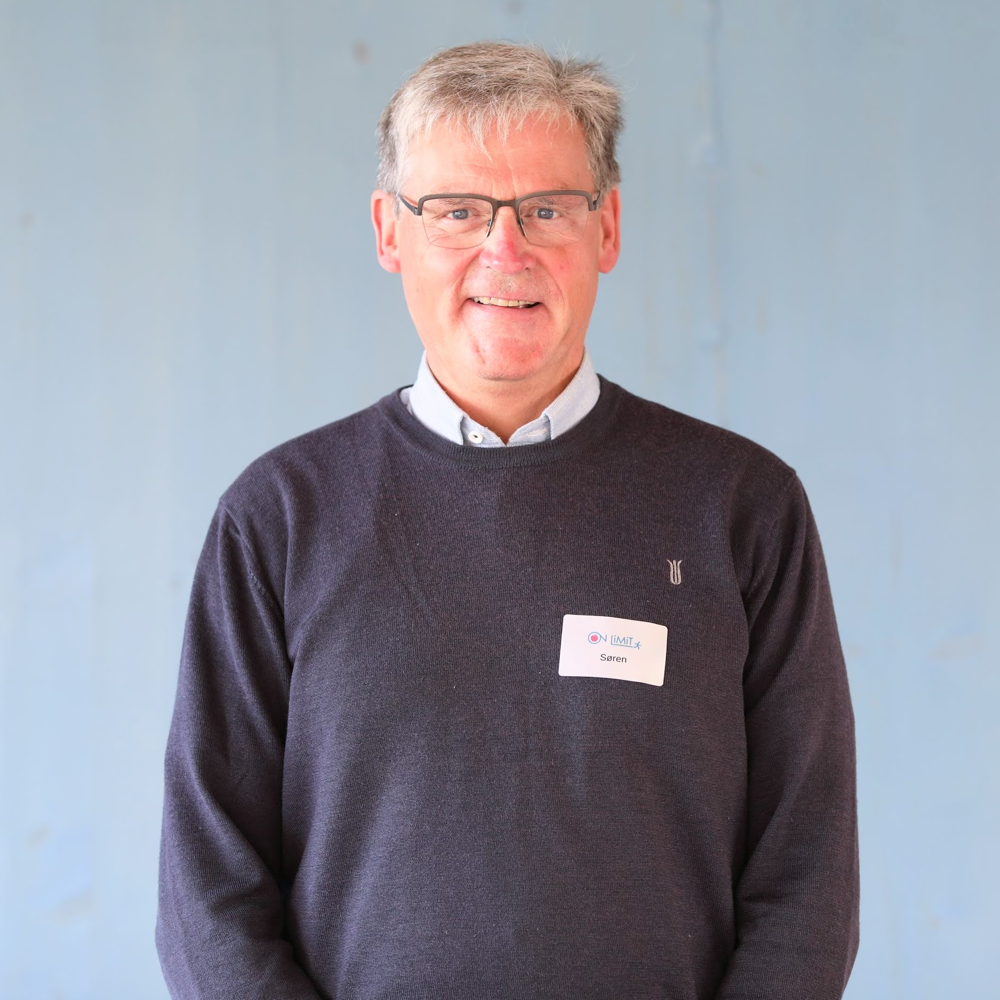
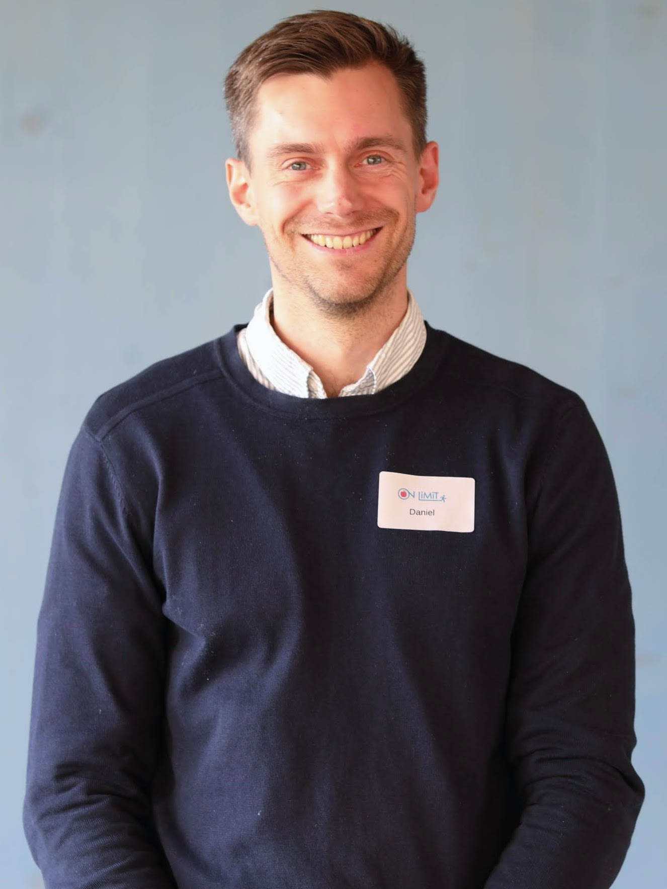
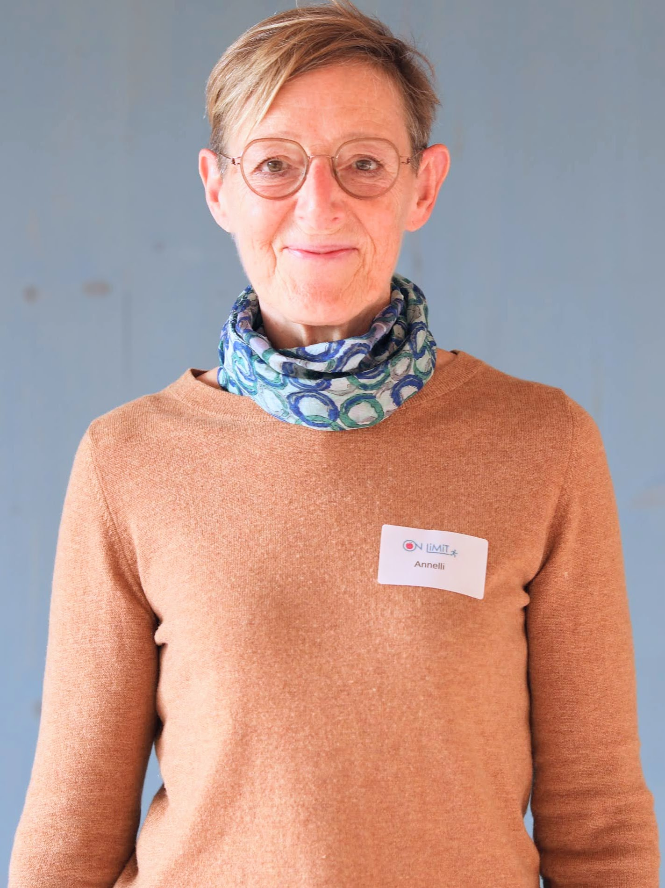
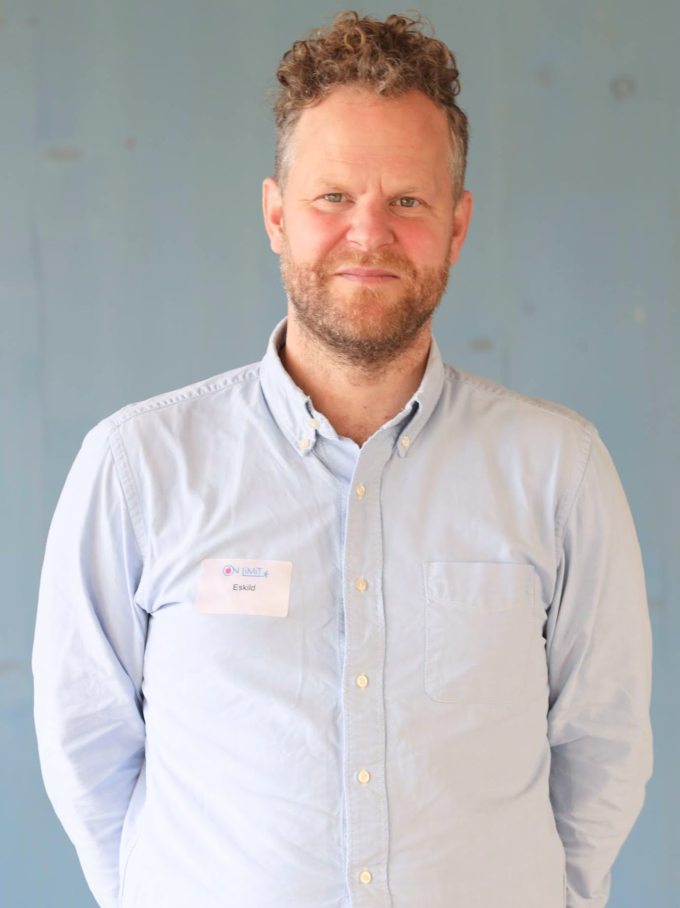
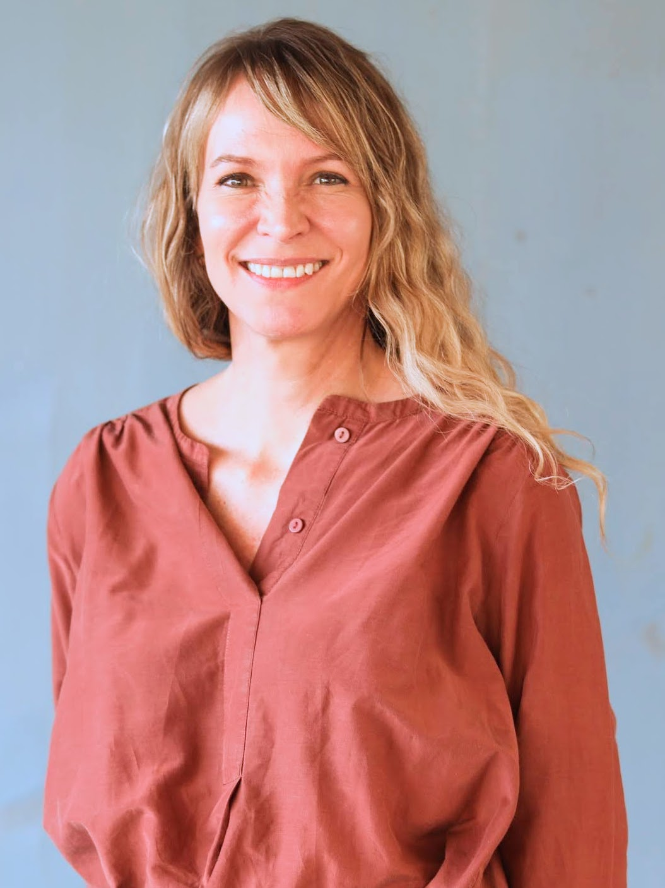
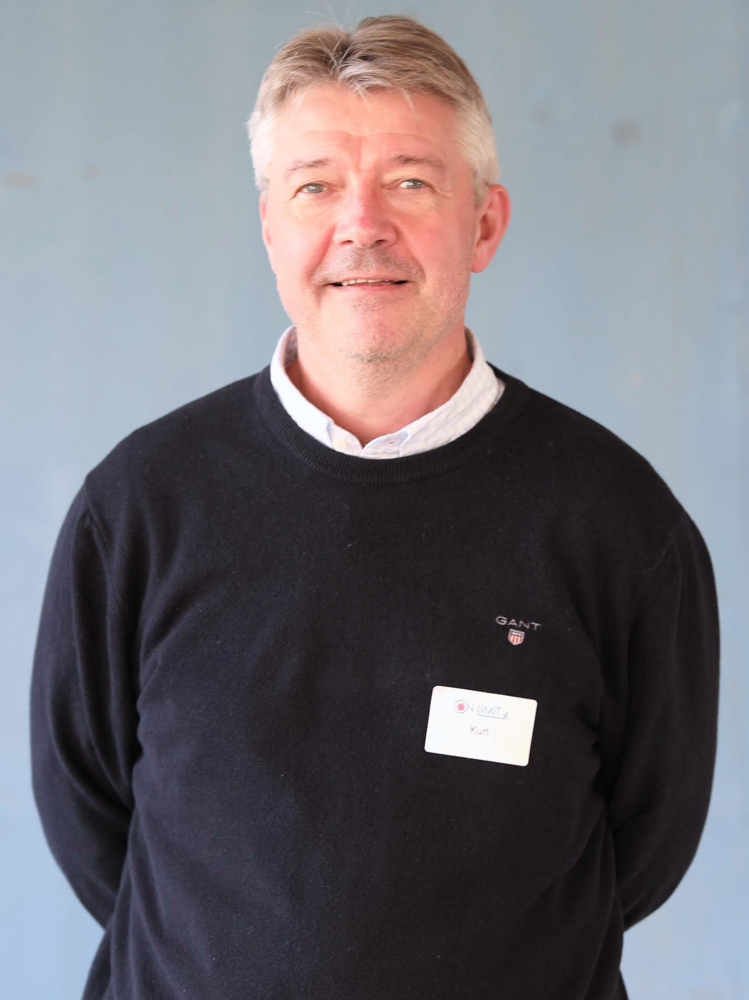
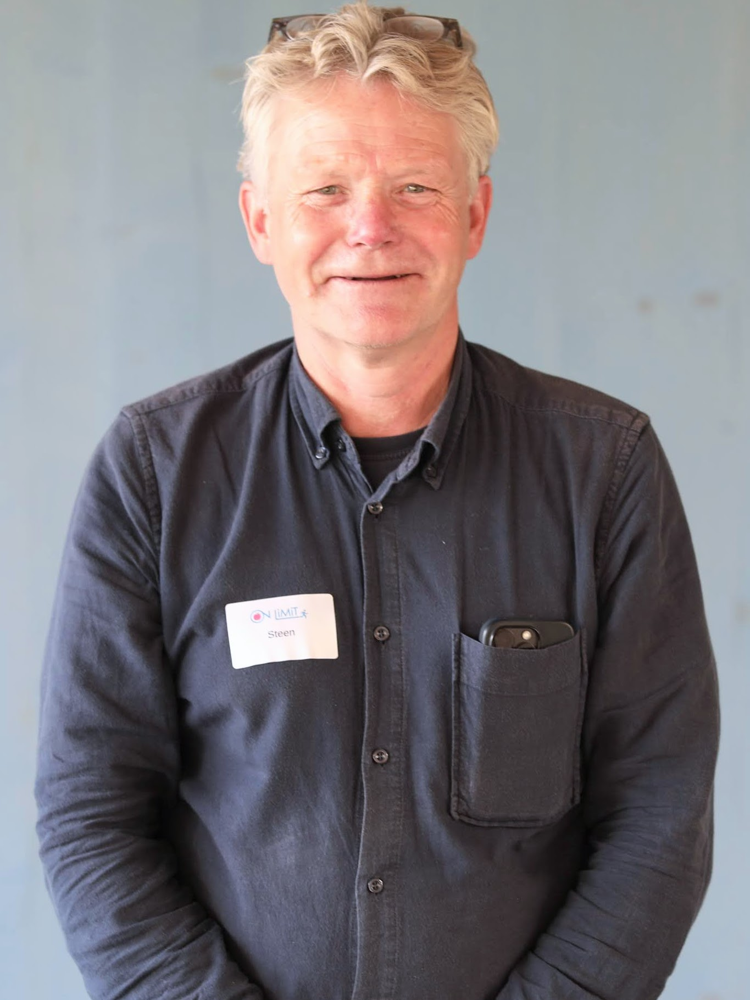
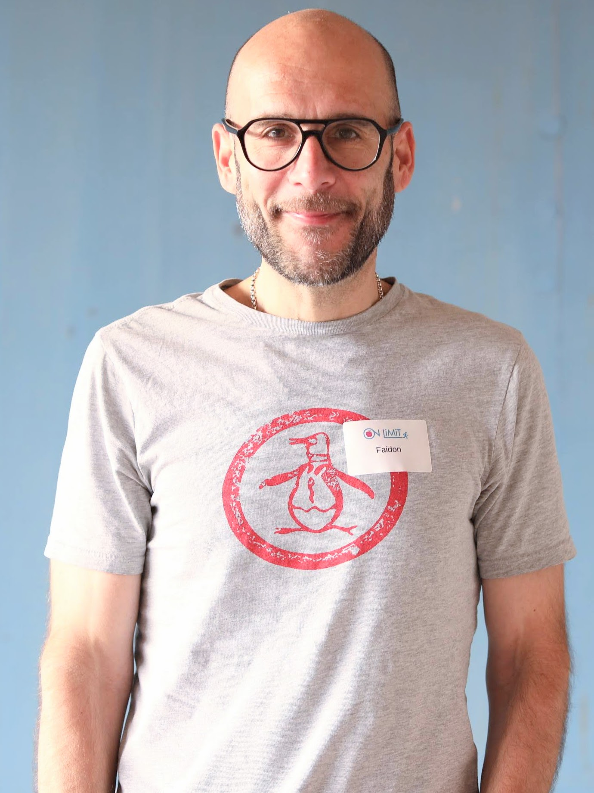
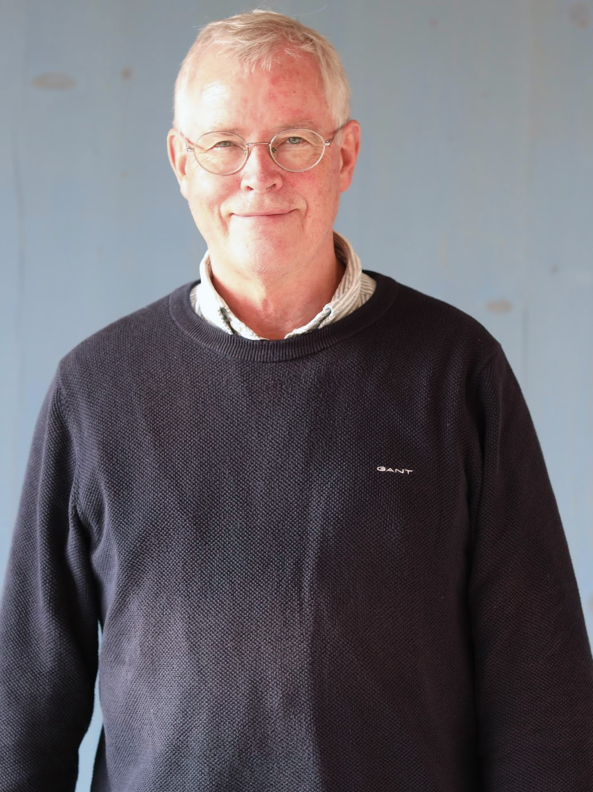

# Hvem står bag ON LiMiT

ON LiMiT (Optimal Non-pharmacological LifeStyle Modifications in people
with Type 2 diabetes), er et samarbejde mellem 6 partnere:

-   Steno Diabetes Center Aarhus ved Aarhus Universitet og Aarhus
    Universitetshospital
-   Steno Diabetes Center København, Region Hovedstaden
-   Steno Diabetes Center Odense, Region Syddanmark
-   Bispebjerg Hospital, Region Hovedstaden
-   Institut for Idræt og Ernæring ved Københavns Universitet
-   Novo Nordisk Foundation Center for Basic Metabolic Research ved
    Københavns Universitet universitet og Bispebjerg hospital

# Forskerne i projektet

## Steno Diabetes Center Aarhus

**Principal investigator**\
{.profile-picture}

Hovedansvarlig for projektet. Professor i ernæring.

**Project manager and work package leader**\
{.profile-picture}

Projektleder og arbejdspakkeleder. Daniel er lektor og seniorforsker ved
Steno Diabetes Center Aarhus og Institut for Folkesundhed ved Aarhus
Universitet. Som projektleder i ON LiMiT står han for den overordnede
koordinering og planlægning af projektet i samarbejde med
projektledelsen. Han er ansvarlig for arbejdspakken, der undersøger
klimabelastningen af deltagernes kost samt arbejdspakken for
dataopsamling i projektet. Udover ON LiMiT, undersøger han hvordan sund
og bæredygtig kost påvirker personer med type 2-diabetes, hvordan vi
objektivt måler kostindtag og rent metodisk integrerer avancerede
epidemiologiske analyser i ernæringsstudier.

**Work package leader**\
{.profile-picture}

Arbejdspakkeleder. Professor.

**Work package leader**\
{.profile-picture}

Arbejdspakkeleder. Seniorforsker.

## Steno Diabetes Center Copenhagen

**Work package leader**\
{.profile-picture}

Arbejdspakkeleder. Lektor og seniorforsker.

**Work package leader**\
{.profile-picture}

Bettina er klinisk forsker, ph.d. og leder af Klinik for Ernæring på
Steno Diabetes Center Copenhagen. I ON LiMiT-projektet er Bettina
ansvarlig for arbejdspakken, der handler om at udvikle og afprøve
diætinterventionen, samt for diætisternes gennemførelse af
kostinterventionerne i projektet. Derudover er hun medansvarlig for
udvikling og afprøvning af ON LiMiT-pilotprojektet og for gennemførelsen
af det store lodtrækningsforsøg på Steno Diabetes Center Copenhagen. Ved
siden af ON LiMiT forsker Bettina i, hvordan forskellige
diætbehandlingsforløb kan støtte mennesker med type 1-diabetes, type
2-diabetes, graviditetsdiabetes og anden kronisk sygdom i at opnå et
bedre helbred og højere livskvalitet. Hun arbejder blandt andet med
kostinterventioner, patientuddannelse og digitale løsninger, der kan
gøre det lettere at ændre kostvaner og leve godt med diabetes.

## Steno Diabetes Center Odense

**Site leader**\
{.profile-picture}

Kurt Højlund er forskningschef, klinisk professor og overlæge ved Steno
Diabetes Center Odense, Odense Universitetshospital og Klinisk Institut,
Syddansk Universitet. Som projektleder i ON LiMiT står han for den
overordnede koordinering og planlægning af projektet i samarbejde med
projektledelsen. Han er ansvarlig for gennemførelse af hovedprojektet
med Steno Diabetes Center Odense som study site for knap 200
projektdeltagere. Udover ON LiMiT, undersøger han mekanismerne bag
insulinresistens, beta-celle dysfunktion og fedtvævsdysfunktion ved type
2-diabetes, fedme og andre prædiabetiske tilstande, samt hvordan
forskellige former for vægttab, fysisk aktivitet og kostintervention
påvirker disse mekanismer.

## Bispebjerg Hospital

**Work package leader**\
{.profile-picture}

Arbejdspakkeleder og professor.

## Institut for Idræt og Ernæring

**Site leader**\
{.profile-picture}

Faidon Magkos er professor i fedme og metabolisme ved Institut for Idræt
og Ernæring (NEXS) på Københavns Universitet. Han har en BSc i human
ernæring, en MSc i kost og motion samt en ph.d. i human metabolisme. Han
har studeret ved Harokopio University (Grækenland), Washington
University School of Medicine (St. Louis, USA) og Harvard Medical School
(Boston, USA). Han har udgivet mere end 250 videnskabelige artikler.
Hans forskning kredser om effekterne af kost og motion på kroppens
vægthomeostase og metaboliske funktion, de kardiometaboliske
komplikationer ved overskydende fedtophobning, og hvordan disse kan
udbedres gennem vægttab. I ON LiMiT-projektet er Faidon "site leader"
hos NEXS, hvor cirka 300 deltagere vil blive undersøgt via detaljerede
målinger af kropssammensætning og metabolisk funktion.

## Novo Nordisk Foundation Center for Basic Metabolic Research

**Work package leader**\
{.profile-picture}

Arbejdspakkeleder og professor.
