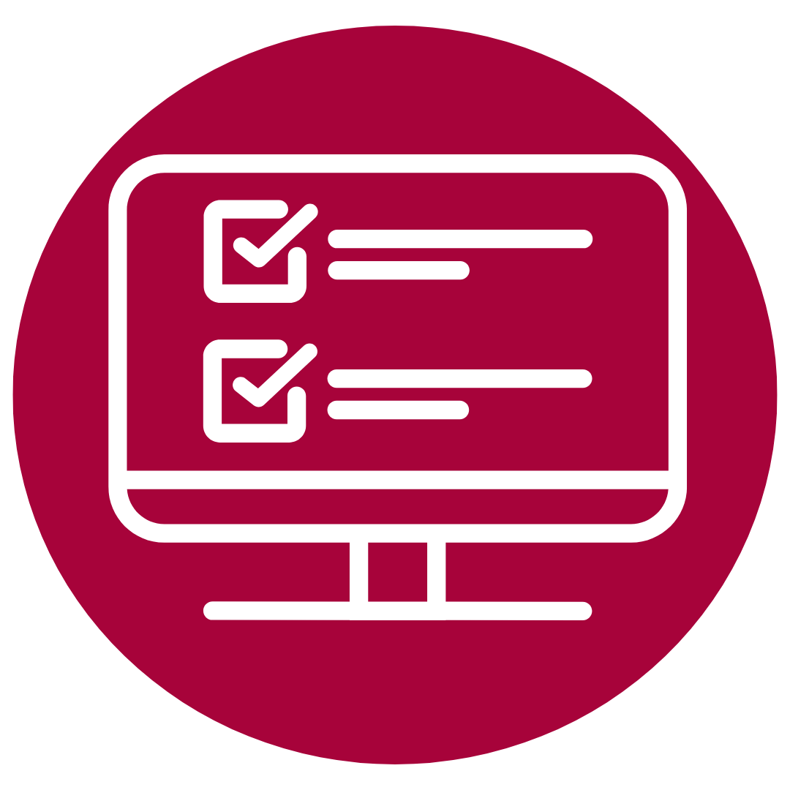
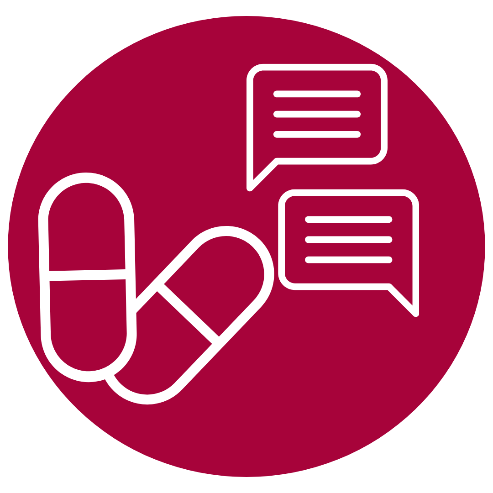

## Kan jeg som læge henvise patienter til projektet?

Praktiserende læger i Albertslund, Ballerup, Brøndby, Glostrup, Herlev
og Vallensbæk kommuner inviteres til at deltage i feasibilitystudiet.

Hvis din klinik ønsker at deltage eller høre mere, er I velkommen til at
kontakte projektkoordinator Line Olesen på:

📧 ligole\@rm.dk

☎️ 2370 4053 (Hverdage kl. 11-14)

## Tilmelding

Der er plads til ca. 6 lægeklinikker i feasibilitystudiet.

Udfyld tilmeldingsformularen for at tilmelde jeres lægepraksis.

Ved at udfylde formularen accepterer du, at vi behandler dine
oplysninger i projektet. Vi bruger de indtastede oplysninger til at
registrere tilmeldinger og kontakte jer efterfølgende.

Tilmeldingen er først registreret, når du har trykket på "Submit" og du
får beskeden: "Tak for din tilmelding til ON LiMiT".

-   Du vil senest 3 hverdage efter tilmeldingen modtage en
    bekræftelsesmail.
-   Hvis pladserne allerede er fyldt, bliver din klinik skrevet på en
    interesseliste til hovedstudiet, og du vil blive informeret herom.

<iframe title="Tilmeldingsformular" src="https://redcap.au.dk/surveys/?s=W4EX7W97EPYXE8EX" width="100%" height="1000px" style="border: 6px solid black">

</iframe>

## Rekruttering af patienter

Patienterne identificeres i klinikken ud fra udvalgte in- og
eksklusionskriterier (se nedenfor). Forventningen er ca. 10 potentielle
deltagere pr. lægekapacitet.

De praktiserende læger inviterer relevante patienter til at få mere
information om ON LiMiT. Invitationerne sendes elektronisk via
praksissystemet eller evt. med brevpost (hvis patienten ikke modtager
elektroniske beskeder).

Når en patient tilmelder sig mere information, sendes der automatisk
skriftligt materiale til patientens mail. En projektmedarbejder fra et
nærliggende Steno Diabetes Center kontakter herefter patienten
telefonisk indenfor 3 hverdage for at:

-   give mundtlig information
-   screene for supplerende eksklusionskriterier (fx BMI \> 27)
-   invitere til screeningssamtale med mulighed for at afgive samtykke

### Inklusionskriterier

-   Diagnosticeret med type 2 diabetes (varighed ≤ 6 år)
-   HbA1c mellem 36-86 mmol/mol (med eller uden antidiabetisk medicin)
-   18-75 år

### Eksklusionskriterier

-   Insulinbehandling inden for 6 måneder før screening (alle typer)
-   Kendt nyresygdom og behandles med SGLT-2-hæmmer (aktuelt eller
    planlagt)
-   Kendt hjerteinsufficiens og behandlet med SGLT-2-hæmmer
-   Igangsættelse af GLP-1RA-baseret behandling for indikationer, der
    ikke er relateret til type 2-diabetes eller vægttab
-   Kendt alkohol- eller stofmisbrug
-   Kendt tvangsoverspisning
-   Kendt psykiatrisk sygdom - hvor det vurderes, at personen ikke kan
    gennemføre interventionen

## Hvad er min rolle som praktiserende læge under projektet?

De praktiserende læger er nøglepersoner i rekrutteringen, og bevarer
behandlingsansvaret i hele projektperioden.

Deltagerne bliver bedt om at stoppe med at tage diabetes- og
blodtryksmedicin ved opstart i vægttabsfasen, og skal kun tage medicin i
tilfælde af tilbagefald af diabetes.

Forsøgsstedet monitorerer løbende HbA1c og blodtryk, mens deltagerne
selv udfører supplerende sikkerhedsmålinger (fingerprik, kontinuerlig
glukosemåling (CGM) og hjemmemåling af blodtryk). Disse målinger
uploades til forsøgsstedet gennem ON LIMIT appen.

Hvis forsøgsstedet måler to separate HbA1c \>53 mmol/mol, anbefales
genoptagelse af diabetesmedicin. Den praktiserende kontaktes via en
korrespondancemeddelelse og anbefales at genoptage diabetesmedicin jf.
DSAM/DES retningslinjer. Deltageren opfordres til at fortsætte i
projektet.

## Projektets forløb i almen praksis

::: {layout="[10, 90]"}
{.icon
fig-alt="An icon showing a computer with a video symbol on the screen."}

### Oplæring

-   Start med at læse manualen.
-   Se evt. instruktionsvideoen og/eller deltag i webinar.
:::

::: {layout="[10, 90]"}
{.icon
fig-alt="An icon showing a magnifying glass."}

### Identificer potentielle deltagere

-   Find type 2-patienter via forløbsoverblikket.
-   Brug in- og eksklusionskriterier til at identificere potentielle
    deltagere.
:::

::: {layout="[10, 90]"}
{.icon
fig-alt="An icon showing a letter and a telephone."}

### Inviter potentielle deltagere og følg op

-   Send invitation til potentielle deltagere via praksissystemet eller
    brevpost.
-   Følg op med telefonisk kontakt til patienter, der ikke har til-
    eller frameldt sig.
:::

::: {layout="[10, 90]"}
{.icon
fig-alt="An icon showing a computer screen with checkmarks."}

### Udfyld rekrutteringsskema

-   Indtast data om antal patienter i målgruppen, antal potentielle
    deltagere og antal, der har takket nej.
:::

::: {layout="[10, 90]"}
{.icon fig-alt="An icon showing a rocket."}

### Medicin-seponering

-   Modtag korrespondancemeddelelse om medicin-seponering.
-   Seponer diabetes- og blodtryksmedicin.
:::

::: {layout="[10, 90]"}
{.icon
fig-alt="An icon showing medicine and two dialogue boxes."}

### Eventuel genoptagelse af medicinsk behandling

-   Fortsat behandlingsansvar og vanlig kontakt med deltagere.
-   Ved to separate HbA1c-målinger eller systolisk blodtryk over 140
    mmHg informerer forsøgsstedet klinikken.
-   Send en meddelelse retur med information om genoptagelse af medicin.
:::
